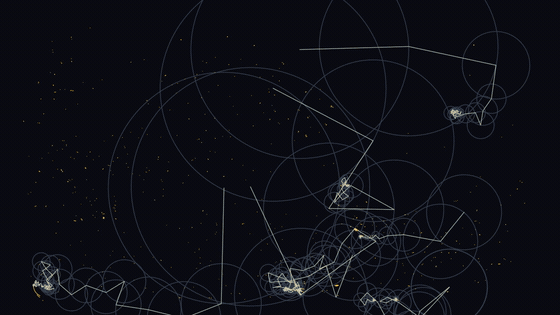
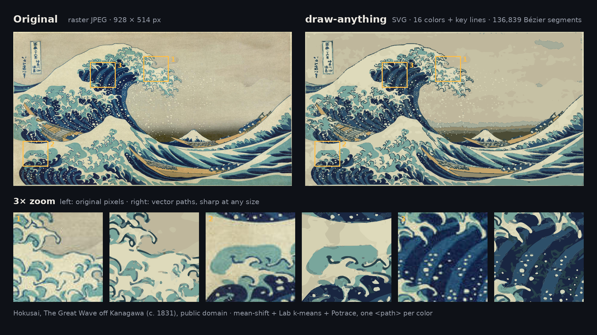
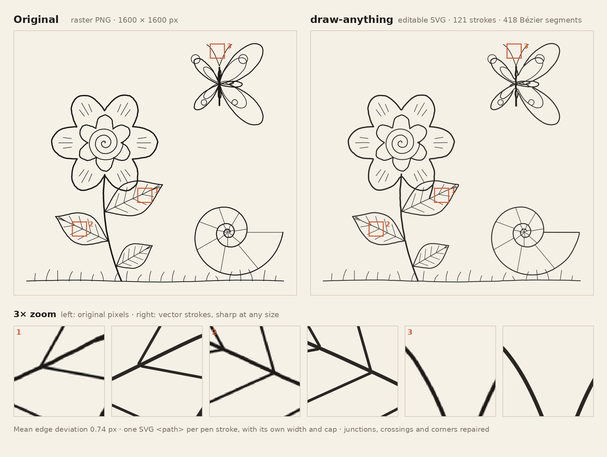

# draw-anything

An Agent Skill for Claude that draws and copies images with math, and exports them for video creators.



[Watch the showcase video (MP4)](assets/showcase.mp4) · [Great Wave demo (MP4)](assets/great-wave-demo.mp4) · [Line-art demo (MP4)](assets/draw-anything-demo.mp4) · [Star in epicycles (MP4)](assets/star-centerline-fourier.mp4)

## Examples



*Color mode with `--lines`: 16 colors plus the key lines, one SVG path for each color.*



*Centerline mode: 121 editable pen strokes, each with its own width. Mean edge deviation 0.74 px.*

## Which method to use

| You ask for | Method | Script |
|---|---|---|
| Copy an image (drawing, logo, lettering, illustration, photo) | Bézier vectorization (Potrace). Add `--centerline` for editable strokes. | `trace_image.py` |
| A name, a signature or an outline drawn by rotating circles | Fourier series (epicycles) | `fourier_draw.py` |
| Filled shapes: icon, mascot, logo, pattern, mandala | Signed distance functions (SDF) | `sdf.py` (library) |
| An equation as the subject: heart curve, rose, spiral, Lissajous | Implicit, parametric and polar curves | `curves.py` |
| Pixel art, "a formula that draws itself" | Tupper's self-referential formula | `tupper.py` |

Each script exports some of these formats: PNG, SVG, MP4, GIF, MOV and WebM with a transparent background, PNG sequences, and Desmos equations.

## Install

### Claude.ai and the Claude desktop app

1. Build the package: `python scripts/package_skill.py`. This makes `dist/draw-anything.skill` (a ZIP file with the `draw-anything/` folder at the root).
2. Turn on code execution and file creation in **Settings > Capabilities** ("Create and edit files").
3. Go to **Customize > Skills**, click **+**, then **Create skill > Upload a skill**, and select the file.

The menu names can change. If they are different, read [Use Skills in Claude](https://support.claude.com/en/articles/12512180-use-skills-in-claude). On Team and Enterprise plans, an owner must turn on skills first.

### Claude Code

Copy the skill folder to your personal skills folder (for all projects):

```bash
cp -r skills/draw-anything ~/.claude/skills/
```

Or copy it to the skills folder of one project:

```bash
cp -r skills/draw-anything .claude/skills/
```

Install the Python packages and `ffmpeg`:

```bash
pip install -r requirements.txt
```

## Use

Ask Claude in plain words. Examples:

- "Copy this logo with math and give me an SVG."
- "Trace my sketch as editable strokes for Illustrator."
- "Write my name with rotating circles, as a 9:16 video for Reels."
- "Draw a cat with SDF in a paper theme."
- "Make the heart equation in Desmos."
- "Turn this pixel art into a Tupper formula."
- "Copy this wave and give me a transparent .mov for my edit."

Claude selects the method and runs the scripts. You can also run the scripts yourself:

```bash
python scripts/trace_image.py drawing.jpg --svg d.svg --png d.png --desmos d.txt
python scripts/trace_image.py sketch.png --centerline --svg sketch.svg
python scripts/trace_image.py art.jpg --mode color --colors 16 --lines --svg art.svg
python scripts/trace_image.py logo.png --transparent --anim logo.mov --size reels
python scripts/fourier_draw.py --text "Ana" --terms 300 --anim ana.mp4 --size reels
python scripts/curves.py --polar "1+0.3*cos(7*th+6.283*a)" --anim flower.mp4
python scripts/tupper.py encode --text "HELLO" --png tupper.png --out k.txt
```

Run a script with `--help` for all options. [SKILL.md](skills/draw-anything/SKILL.md) has the full procedure.

## Benchmark

The [vectorization benchmark](benchmark/) uses a synthetic dataset with exact ground truth: 17 kinds of line art and shapes, standard and unusual (hairlines, JPEG artifacts, noise, blur, tiny input, stipple, paper texture and more). Each case has a degraded input (320 px) and a clean ground truth at 4×. Seeds 0–1 are the train split (for tuning). Seed 2 is the test split (held out).

Metrics (the output SVG is rendered at 4× and compared with the ground truth):

| Metric | Meaning |
|---|---|
| IoU | Overlap of the ink areas. Higher is better. |
| Mean edge deviation | Mean distance between the output edges and the true edges, in input pixels. |
| h95 | 95th percentile of the same distance: the worst-case shape error. |
| Euler error | Difference of the Euler number: wrong holes, or extra or missing parts. |
| Segments, size, time | Complexity of the SVG and run time. |

Results on the test split, fill mode (17 cases). "Before" is the recorded result of the first version. "v0.1.0" is a new run of this repository (`python benchmark/bench.py '{}' all`):

| Fill mode, test split | Before | v0.1.0 |
|---|---|---|
| IoU | 0.898 | **0.911** |
| Mean edge deviation | 0.85 px | **0.22 px** |
| h95 | 4.54 px | **0.45 px** |
| Euler error | 29.9 | **0.9** |
| Bézier segments | 716 | **602** |

Centerline mode, test split (13 cases): IoU 0.836, mean edge deviation 0.32 px, h95 0.70 px, Euler error 0.6.

The recorded "after" result for this version had a fill IoU of 0.907. The new run gives 0.911. The difference is in one case (`text_2`), because the newer matplotlib draws the text differently. Run times are not comparable between machines. The full results are in [benchmark/results_v0.1.0_all.json](benchmark/results_v0.1.0_all.json).

## Known limitations

- **Blurry images:** fill IoU is approximately 0.62 (Gaussian blur, σ 2.2).
- **Lines thinner than 1 px:** fill IoU is approximately 0.67.
- **Very small images** (106 px): fill IoU is approximately 0.74.
- **Centerline mode** gives one stroke width for each stroke. It cannot copy brush strokes that change width.
- **Color mode** changes smooth gradients (for example, skies) into bands.
- **Color mode** has no benchmark yet.

## Showcase video

The source of the showcase video is in [showcase/](showcase/) (Remotion). To render it again:

```bash
cd showcase && npm install && npm run render
```

## Contribute

Read [CONTRIBUTING.md](CONTRIBUTING.md). Run the tests with `pytest -m "not slow"`.

## Credits

- *The Great Wave off Kanagawa*, Katsushika Hokusai, c. 1831. Public domain.
- Vectorization uses [Potrace](https://potrace.sourceforge.net/) by Peter Selinger, through the [potracer](https://pypi.org/project/potracer/) Python port.
- All other example images come from code in this project.

## License

MIT. See [LICENSE](LICENSE).

The `potracer` dependency has the GPLv2+ license. This repository does not include it: pip installs it separately. If you distribute a bundle that includes `potracer`, obey its license.
